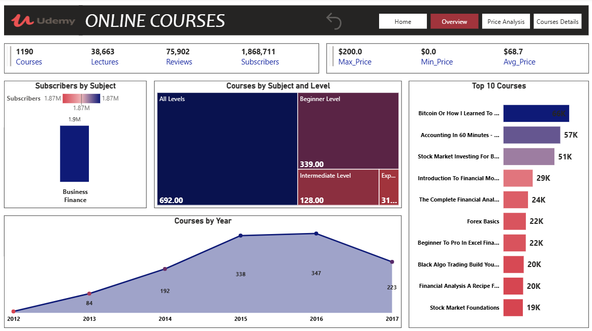
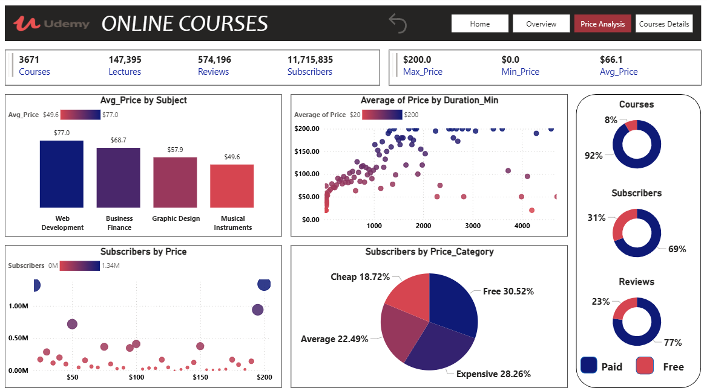
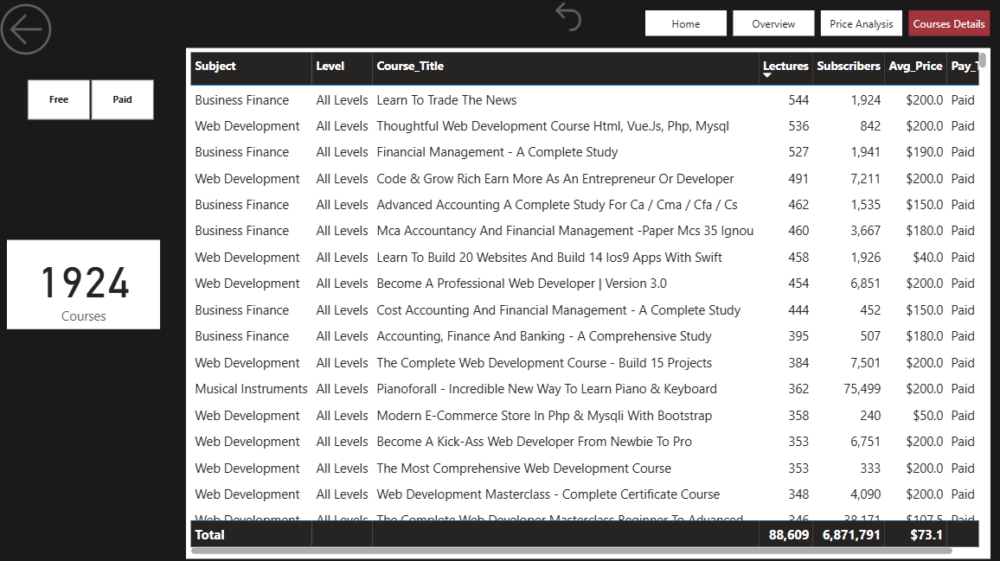

# 🎓 Udemy Online Courses & Pricing Strategy Analytics (Power BI)

## 📌 Project Overview
A multi-page interactive **Business Intelligence Dashboard** built with **Microsoft Power BI** to analyze **3,671 online courses**, **147,395 lectures**, **574,196 reviews**, and **11,715,835 subscribers** on the **Udemy** e-learning platform (2012 – 2017).

The report is designed as a full web-like analytical application featuring **4 navigation views** (`Home`, `Overview`, `Price Analysis`, and `Courses Details`) to help course creators and platform managers optimize pricing models, course length, and subject targeting.

---

## 📂 Dataset & Database Access
The raw dataset and project files used in this analysis can be accessed via Google Drive:
* 🔗 **[Download Dataset & Project Files from Google Drive](PASTE_YOUR_GOOGLE_DRIVE_LINK_HERE)**

---

## 🖼️ Dashboard Pages Preview

### 1️⃣ Page 1: Overview & Subject Deep-Dive (Filtered Example: Business Finance)

### 2️⃣ Page 2: Price & Monetization Analysis

### 3️⃣ Page 3: Granular Courses Details & Drill-Through Table

---

## 🎯 Overall Platform KPIs
* **Total Courses Analyzed:** `3,671 Courses` (`92% Paid` vs. `8% Free`)
* **Total Subscribers:** `11,715,835 Learners` (`69% Paid` vs. `31% Free`)
* **Total Lectures:** `147,395 Lectures`
* **Total Student Reviews:** `574,196 Reviews` (`77% Paid` vs. `23% Free`)
* **Pricing Metrics:** Max Price `$200.0` | Min Price `$0.0` | Overall Average Price `$66.1`

---

## 🔍 Key Business Insights Uncovered

1. **Paid vs. Free Efficiency (The 8% Paradox):**
   * Although **Free courses** represent only **8%** of the total catalog on Udemy, they attract **31% of total subscribers** and **23% of total reviews**, acting as a powerful top-of-funnel acquisition channel.
   * **Paid courses (92%)** dominate revenue and engagement, capturing **69% of subscribers** and **77% of reviews**.

2. **Subject Pricing Power:**
   * **Web Development** commands the highest average course price at **`$77.0`**, followed by **Business Finance (`$68.7`)**, **Graphic Design (`$57.9`)**, and **Musical Instruments (`$49.6`)**.

3. **Subscriber Distribution by Price Tier:**
   * Courses were segmented into 4 pricing tiers (`Free`, `Cheap`, `Average`, and `Expensive`).
   * **Free (`30.52%`)** and **Expensive (`28.26%`)** tiers capture the largest share of subscribers, followed by **Average (`22.49%`)** and **Cheap (`18.72%`)**. This proves that learners are willing to pay premium prices (`$150–$200`) when perceived value and course duration are high.

4. **Business Finance Domain Breakdown (1,190 Courses | 1.87M Subscribers):**
   * Most courses target **All Levels (`692 courses`)** and **Beginner Level (`339 courses`)**, while **Intermediate (`128`)** and **Expert (`31`)** levels remain underserved market gaps.
   * Course creation grew rapidly from **2013 (`84 courses`)** to peak in **2015 (`338`)** and **2016 (`347`)**.
   * Top-performing finance courses include *Bitcoin Or How I Learned To...* (`66K subscribers`), *Accounting in 60 Minutes* (`57K`), and *Stock Market Investing* (`51K`).

---

## 🛠️ Tech Stack & Power BI Capabilities Used
* **Tool:** Microsoft Power BI Desktop
* **ETL & Data Transformation:** Power Query (Data cleaning, conditional columns for `Price_Category` segmentation, and data type standardization).
* **DAX & Modeling:** Custom measures for `Max_Price`, `Min_Price`, `Avg_Price`, subscriber counts, and percentage breakdowns.
* **UI/UX & Interactivity:**
  * App-like multi-page navigation bar (`Home`, `Overview`, `Price Analysis`, `Courses Details`) and Reset/Back buttons.
  * Scatter plots analyzing correlation between `Price`, `Duration_Min`, and `Subscribers`.
  * Treemaps, Donut charts, and detailed tabular views with Free/Paid slicers.

---

## 📬 Contact & Connect
* **Author:** Mohamed Elkalaf
* **LinkedIn:** [in/mohamed-al-kalaf-305325326](https://www.linkedin.com/in/mohamed-al-kalaf-305325326)
* **Email:** mhmdelkalaf435@gmail.com
